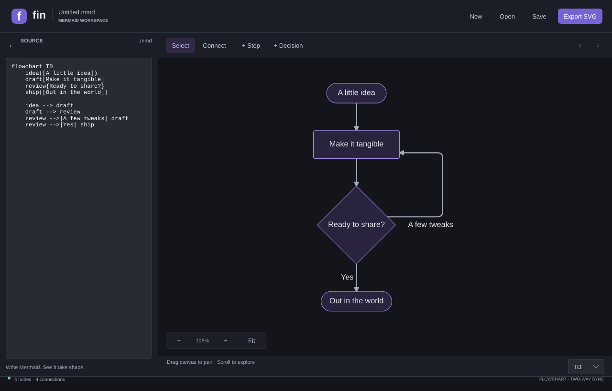

# Fin

A small, native Mermaid workspace built with Rust, with a Slint desktop interface and a Ratatui terminal interface. Write the diagram on the left, explore it on the right, or build a flowchart visually and let Fin write the Mermaid. Both interfaces start in dark mode.

**This project is vibe coded:** built iteratively with AI assistance, with a human guiding the direction and reviewing the results.

Inspired by [Mermaid Live Editor](https://github.com/mermaid-js/mermaid-live-editor). Runs locally without a browser, Node.js, or a rendering service.



## Run

### With Pixi

Install [Pixi](https://pixi.sh/latest/installation/), then run:

```sh
pixi install --locked
pixi run --locked run
pixi run --locked run examples/welcome.mmd
pixi run --locked tui examples/welcome.mmd
```

[`pixi.toml`](pixi.toml) supplies Rust 1.99.0 (including Cargo, rustfmt and Clippy), Git, pkg-config, native C/C++ compiler packages, and Linux font/window-system libraries plus the DejaVu Sans diagram font. [`pixi.lock`](pixi.lock) records the resolved tools and native dependencies; `Cargo.lock` records Rust crates. Keep both lockfiles in Git. The environment lives in the ignored `.pixi/` directory and does not replace your global tools. Use `pixi shell` to work with its tools directly, or prefix commands with `pixi run --locked`.

The environment resolves for Linux x86_64/ARM64, macOS Intel/Apple Silicon, and Windows x86_64/ARM64. macOS still needs Xcode command-line tools and its SDK (`xcode-select --install`); Windows needs Visual Studio C++ Build Tools and the Windows SDK. Linux desktop execution still needs a running X11/Wayland session and an appropriate XDG desktop portal for native file dialogs. Pixi supplies development libraries, not a desktop session. The standalone TUI runs without a desktop session.

```sh
pixi run --locked build       # Optimized desktop and terminal executables
pixi run --locked build-tui   # Optimized standalone terminal executable
pixi run --locked verify      # Formatting, Clippy, and tests for both feature sets
pixi run --locked fmt         # Apply Rust formatting
pixi task list               # All available tasks
```

Pixi builds go into `target/pixi/` to keep their native library linkage separate from host-toolchain builds. Run them through Pixi; for example, `pixi run --locked ./target/pixi/release/fin-tui --help` (append `.exe` on Windows). These development builds may depend on libraries in `.pixi/`; use the existing CI archives for distribution. To deliberately refresh dependencies, run `pixi update`, review the lockfile diff, and run `pixi run --locked verify`.

### With a system Rust toolchain

Install [Rust](https://rustup.rs/) 1.92 or newer, then:

```sh
cargo run --release --locked
# Open an existing diagram:
cargo run --release --locked -- examples/welcome.mmd
```

For standalone executables, run `cargo build --release --locked`. The output is `target/release/fin` and `target/release/fin-tui` on macOS/Linux, with `.exe` extensions on Windows.

- **Windows:** use the MSVC Rust toolchain and Visual Studio C++ build tools.
- **macOS:** install Xcode command-line tools (`xcode-select --install`).
- **Linux:** a desktop with X11 or Wayland and a working XDG desktop portal provides the window and native file dialogs. On Debian/Ubuntu, build prerequisites include `build-essential pkg-config libfontconfig1-dev libxkbcommon-dev libwayland-dev libx11-dev libxcb1-dev`. Install an XDG desktop portal backend appropriate for your desktop if file dialogs are unavailable.

The desktop app uses Slint's software renderer.

### Terminal interface

```sh
# Start the TUI through the regular executable:
cargo run --release --locked -- --tui examples/welcome.mmd
# Or use the dedicated terminal executable:
cargo run --release --locked --bin fin-tui -- examples/welcome.mmd
# Build only the terminal application, without Slint or a desktop session:
cargo build --release --locked --no-default-features --features tui --bin fin-tui
```

Run the resulting `fin-tui` executable in a Unicode-capable terminal, locally or over SSH. It shares Mermaid documents, rendering, undo history behavior, and flowchart editing with the desktop interface. Save a `.mmd` file to move between interfaces; separate running instances do not automatically synchronize edits.

Use **Tab** to switch between Source and Graph, **Ctrl + B** to collapse Source, and **F1** for help. Source starts in Vim **Normal** mode: press **i** to type and **Escape** to return to Normal. The source title shows the current mode, and the footer shows pending commands and searches. Graph uses terminal drawing characters with readable text labels; other supported Mermaid diagrams use a portable half-block image preview. Terminal resolution limits visual detail, while SVG export preserves vector geometry.

| Shortcut | Terminal action |
| --- | --- |
| Ctrl + N / O / S | New / Open / Save |
| F4, Ctrl + Shift + S | Save as (F4 works when the terminal cannot distinguish Ctrl + Shift + S) |
| Ctrl + E | Export SVG |
| Ctrl + Z / Y | Undo / Redo |
| Ctrl + Q | Quit with an unsaved-changes prompt |
| Ctrl + C | Return to Normal in Source; quit with an unsaved-changes prompt in Graph |
| Tab / Ctrl + B / F1 | Switch pane / Toggle Source / Help |
| `a` / `d` in Graph | Add a step / decision |
| `j` / `k`, `]` / `[` in Graph | Select next / previous node |
| `r` / `s` in Graph | Rename selected node / Cycle its shape |
| `c`, select target, Enter in Graph | Connect the selected node to a target |
| `e` in Graph | Edit the selected node's connections |
| Delete in Graph | Delete selected node and its connections |
| Arrow keys / `+` / `-` / `0` in Graph | Pan / Zoom in / Zoom out / Fit |

In the connection editor, **j / k** select an edge, **r** edits its label, **s** cycles its style, and **Delete** removes it. **Escape** closes a dialog or cancels connecting. Open, New, and Quit prompt before discarding unsaved edits: **s** saves, **d** discards, and **Escape** cancels. File paths are entered in terminal dialogs.

Source supports this focused set of Vim commands:

| Source command | Action |
| --- | --- |
| `h` / `j` / `k` / `l`, arrow keys | Move left / down / up / right |
| `w` / `b` / `e` | Next word / previous word / end of word |
| `0` / `^` / `$` | Start of line / first nonblank character / end of line |
| `gg` / `G` | First / last line; a count selects a line, e.g. `12G` |
| `i` / `a`, `I` / `A` | Insert before / after cursor, or at first nonblank character / line end |
| `o` / `O` | Open a new line below / above and enter Insert |
| `d` / `c` / `y` + motion | Delete / change / yank; for example, `dw`, `cw`, or `y$` |
| `dd` / `cc` / `yy` | Delete / change / yank the current line |
| `x`, `D` / `C`, `r` + character, `s` | Delete character; delete / change to line end; replace character; substitute in Insert |
| `v` / `V` | Start character / line selection, then move and use `d`, `c`, or `y` |
| `p` / `P` | Paste after / before the cursor from the internal yank register |
| `u` / Ctrl + R | Undo / redo, including changes made in Graph |
| `/` + text + Enter, `n` / `N` | Literal search, then next / previous match |
| `:w`, `:w path` | Save, or save to a path |
| `:q`, `:q!` | Quit with unsaved-changes protection, or discard changes and quit |
| `:wq`, `:x` | Save and quit |
| `:e path` | Open a file with unsaved-changes protection |
| Escape, Ctrl + C | Return to Normal; cancel a pending command, search, or selection |

Prefix motions and operators with counts, such as `3j`, `2dw`, or `3yy`. Finish `:` commands with Enter. Insert sessions form undo groups, while the live graph continues updating as you type. Existing workspace shortcuts remain available while editing; **Ctrl + B** still toggles Source. Finish or cancel a command/search prompt before using workspace shortcuts. This is a built-in Vim subset, without plugins, macros, named registers, text objects, dot-repeat, or regular-expression search.

For scripts and terminal previews:

```sh
fin-tui --help
fin-tui --version
fin-tui --snapshot 100x32 examples/welcome.mmd
fin-tui --completions bash  # Also zsh and fish
```

`--snapshot` prints a plain-text terminal frame and exits without starting an interactive session.

## Automated builds

[Build and test](.github/workflows/ci.yml) runs on pushes, pull requests, and manual **Actions → Build and test → Run workflow** requests. It uses only standard GitHub-hosted runners, which are [free for public repositories](https://docs.github.com/en/actions/reference/runners/github-hosted-runners#standard-github-hosted-runners-for-public-repositories).

| Platform | Architecture | Runner | Download |
| --- | --- | --- | --- |
| macOS (Intel) | x86_64 | `macos-15-intel` | `fin-macos-x86_64.tar.gz` |
| macOS (Apple Silicon) | ARM64 | `macos-15` | `fin-macos-arm64.tar.gz` |
| Windows | x86_64 | `windows-2025` | `fin-windows-x86_64.zip` |
| Windows | ARM64 | `windows-11-arm` | `fin-windows-arm64.zip` |
| Linux | x86_64 | `ubuntu-24.04` | `fin-linux-x86_64.tar.gz` |
| Linux | ARM64 | `ubuntu-24.04-arm` | `fin-linux-arm64.tar.gz` |

Each job installs its explicit Rust target, checks formatting, runs tests and Clippy for both interfaces and the terminal-only feature set, builds both optimized executables, and uploads the matching archive. The packaged `fin-tui` is built without desktop features. The builds run on the matching CPU architecture, including native Apple Silicon and Windows/Linux ARM64 runners. Separate target cache keys keep the architectures isolated.

Download an archive from the completed workflow's **Artifacts** section and extract it. Archives include `fin` and `fin-tui` (`.exe` on Windows), documentation, examples, and bundled font license; the Unix archives preserve executable permissions for both applications. Artifacts are retained for 14 days. Linux binaries target Ubuntu 24.04's glibc and require compatible system libraries; they are not static binaries. Installers, GitHub Release publishing, code signing, and macOS notarization are not configured.

## Desktop interface

- Edit Mermaid in **Source**. The preview updates after a short pause; an error keeps the last valid preview visible.
- Collapse or expand Source with the chevron.
- Drag the empty canvas to pan, scroll to navigate, and use **− / + / Fit** to zoom. Ctrl/Cmd + scroll also zooms. The visible graph redraws from its SVG at the current zoom and display resolution, keeping text and edges crisp on high-DPI displays.
- Choose **New** for a blank flowchart. **+ Step** and **+ Decision** add nodes.
- Click a node to change its label or shape, then **Apply changes**. Available shapes are rectangle, rounded rectangle, terminal, decision, and circle.
- Choose **Connect**, then click the source and target nodes. Select a connection in either endpoint's inspector to change its label/style or remove it.
- Change the flow direction with **TD / LR / BT / RL**. Layout is automatic; node positions are not stored in Mermaid.
- **Save** writes Mermaid; **Export SVG** writes the current valid diagram as a vector image. New/Open/Close protect unsaved changes with a save prompt.

| Shortcut | Action |
| --- | --- |
| Ctrl/Cmd + N / O / S | New / Open / Save |
| Ctrl/Cmd + Shift + S | Save as |
| Ctrl/Cmd + Z | Undo text or visual edit |
| Ctrl/Cmd + Shift + Z, Ctrl + Y | Redo |
| Ctrl/Cmd + `\` | Toggle Source |
| Ctrl/Cmd + 0 | Fit diagram |
| Escape | Cancel connection mode |

## Mermaid compatibility

Preview uses [mermaid-rs-renderer 0.3.1](https://github.com/1jehuang/mermaid-rs-renderer), a native Rust implementation, rather than Mermaid.js. It supports flowcharts and other diagram families including sequence, class, state, ER, mindmap, pie, and Gantt. Layout, syntax support, and theme behavior can differ from Mermaid Live Editor. Fin starts in dark mode, including the source editor, controls, diagram preview, and exported SVG. It applies its own consistent dark theme independently of the desktop theme.

Two-way visual editing supports `flowchart` / `graph`, TD/TB/LR/RL/BT directions, five node shapes, chains, labeled connections, and arrow/plain/dotted/thick edges. Visual changes normalize formatting and retain ordinary comments. Advanced constructs such as subgraphs, styles, classes, directives, links, and other diagram families stay in **Source editing** mode: Fin previews them where supported and preserves their source without rewriting it.

Files are UTF-8, with a 256 KiB open limit. Rendering is limited to 128 KiB of source, 300 elements, and 1,000 connections. Preview buffers are capped at 8 megapixels each; detailed rendering covers only the visible region, so large offscreen graphs do not reduce normal viewport sharpness. SVG export retains vector geometry. The last 100 source edits are available in undo history; session recovery and syntax highlighting are not implemented.

## Development

```sh
cargo fmt --all --check
cargo clippy --locked --all-targets --all-features -- -D warnings
cargo test --locked --all-targets --all-features
cargo test --locked --no-default-features --features tui --all-targets
cargo clippy --locked --no-default-features --features tui --all-targets -- -D warnings
# Inspect a terminal frame without a terminal or desktop session:
cargo run --locked --no-default-features --features tui --bin fin-tui -- --snapshot 100x32 examples/welcome.mmd
# Capture the actual desktop window, then exit (requires a desktop session):
cargo run --locked -- --snapshot /tmp/fin.png
# Reproducible software-rendered UI snapshots without a desktop:
FIN_SNAPSHOT_DIR=/tmp/fin-ui cargo test --locked software_renderer_draws
```

`src/lib.rs` exposes the shared Mermaid core: `src/flow.rs` owns the safe editable flowchart subset, `src/render.rs` performs background layout, `src/preview.rs` rasterizes SVG regions, and `src/document.rs` owns history and atomic persistence. `ui/app.slint` and `src/main.rs` connect the desktop interface; `src/tui/` provides the Ratatui interface, with CLI options in `src/tui_cli.rs` and its standalone entry point in `src/bin/fin-tui.rs`.

The desktop uses separate workers for source layout and viewport rendering; queued work is coalesced, and stale replies never replace a newer graph or view. A bounded overview remains visible during navigation until the detailed viewport arrives. Tests cover parser round trips, retained unsupported source, rendering and hit bounds, atomic saves, real UI callbacks, zoom/DPI changes, undo/redo, and out-of-order replies. The `desktop` and `tui` Cargo features are both enabled by default; disabling default features and enabling only `tui` keeps Slint and its windowing dependencies out of the terminal executable.

The bundled Liberation Mono editor font is licensed under SIL OFL 1.1; see `assets/FONT-LICENSE.txt`. Slint and the other dependencies retain their respective upstream licenses; review Slint's licensing terms when distributing the application.
